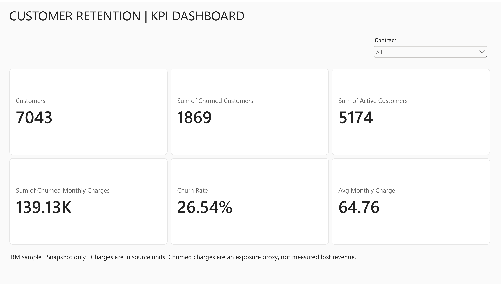
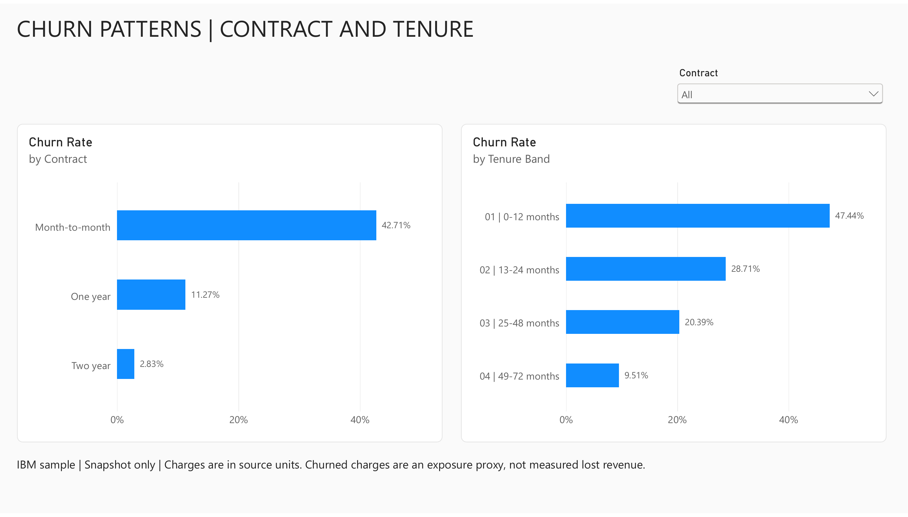
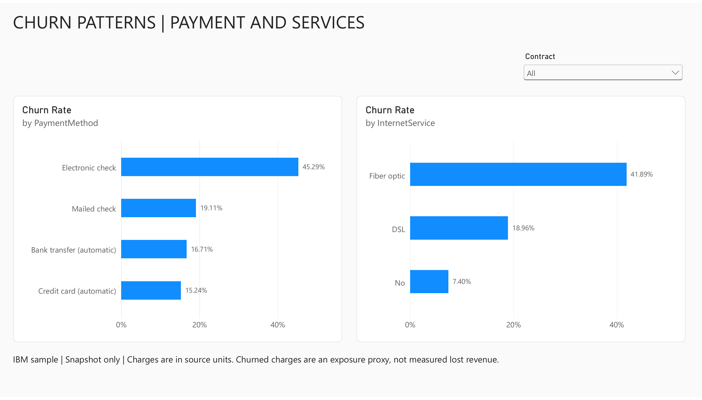

# Customer retention | Power BI churn analysis

A business analysis portfolio case study using IBM's public Telco Customer Churn sample. Three interactive Power BI report pages connect a six-metric KPI dashboard with contract, tenure, payment and service comparisons.

[Download the editable PBIX](reports/customer-retention.pbix) · [View the report PDF](reports/customer-retention.pdf) · [Read the findings](reports/findings.md) · [KPI definitions and business brief](docs/business-requirements.md)

## Retention KPI dashboard



The contract dropdown filters customer counts, observed churn rate, average monthly charge and monthly charges attached to churned records. The live KPI page is also pinned to a separate Power BI service dashboard.

## Business question and findings

Where should a retention team investigate customer experience first?

| Metric | Result |
| --- | ---: |
| Customer records | 7,043 |
| Churned customers | 1,869 |
| Active customers | 5,174 |
| Observed churn rate | 26.54% |
| Average monthly charge | 64.76 |
| Monthly charges associated with churned records | 139,130.85 |

Charges use the source's units; no currency is assumed. The charge total is an **exposure proxy**, not measured lost revenue or a forecast.

Month-to-month customers show **42.71%** churn, versus **11.27%** for one-year and **2.83%** for two-year contracts. Customers with 0–12 months tenure show **47.44%**, versus **9.51%** for 49–72 months. These are associations that motivate an onboarding and contract-experience investigation; they do not prove that contract changes prevent churn.

## Contract and tenure



## Payment and service patterns



Electronic-check customers show **45.29%** churn and fiber-optic customers **41.89%**. These segments overlap and must not be added. A practical next step is customer research into billing and service experiences, followed by a controlled test of any proposed retention intervention.

## What this project demonstrates

- Business requirements translated into KPI definitions and a focused report structure.
- Power Query cleaning with explicit numeric types, null handling, churn indicators and ordered tenure bands.
- DAX ratios that respect current filter context and customer-grain averages.
- Power BI cards, dropdown slicers, sorted bar charts, percentage labels and a live dashboard page.
- Reproducible Python analysis and independent SQLite reconciliation, with source summaries and documented limitations.
- Reporting that separates observed outcomes, proposed actions and unproven business impact.

## Reproduce and inspect

```bash
python -m pip install -r requirements.txt
python scripts/analyze.py
```

The script reads the retained original source, preserves 11 blank TotalCharges values as null, produces a clean CSV and segment summaries, and asserts ID uniqueness, row counts, category values and Python/SQL agreement. Open the PBIX in Power BI Desktop to explore the report. The source Power Query and DAX expressions are in [docs](docs/). [ReportDefinition](ReportDefinition/) contains the service-exported report JSON for review; it is not a separately packaged Desktop project.

## Validation

Baseline values reconcile with the source and SQLite. Selecting Month-to-month in the live Power BI report produces **3,875 customers, 1,655 churned, 2,220 active and 42.71% churn**, matching the contract summary. The default view was restored to All before saving and exporting. The three PDF pages were rendered and visually reviewed; the exported PBIX contains all three 1280×720 pages and 14 visual containers.

## Source and limitations

Source: [IBM Telco Customer Churn repository](https://github.com/IBM/telco-customer-churn-on-icp4d), [original CSV](https://github.com/IBM/telco-customer-churn-on-icp4d/blob/master/data/Telco-Customer-Churn.csv), retrieved 2026-10-24. Original bytes and source SHA-256 are retained in data/ and reports/metrics.json. The upstream repository's [Apache 2.0 license](data/SOURCE-LICENSE.txt) is included for attribution; the dataset remains attributed to its source.

This is an independently authored sample-data portfolio exercise, not client work. The snapshot has no dependable calendar dates, so the report does not invent a time trend or cohort retention curve. Churn labels are observed outcomes, not predictive scores. Eleven missing total-charge values belong to zero-tenure records and remain null. Segment comparisons may reflect confounding and survivorship; recommendations require validation in real operational data. No retention improvement or causal impact is claimed.

[Power BI service links](docs/power-bi-links.md) require the relevant signed-in account and permissions. The PDF and images above are public snapshots for GitHub visitors.
